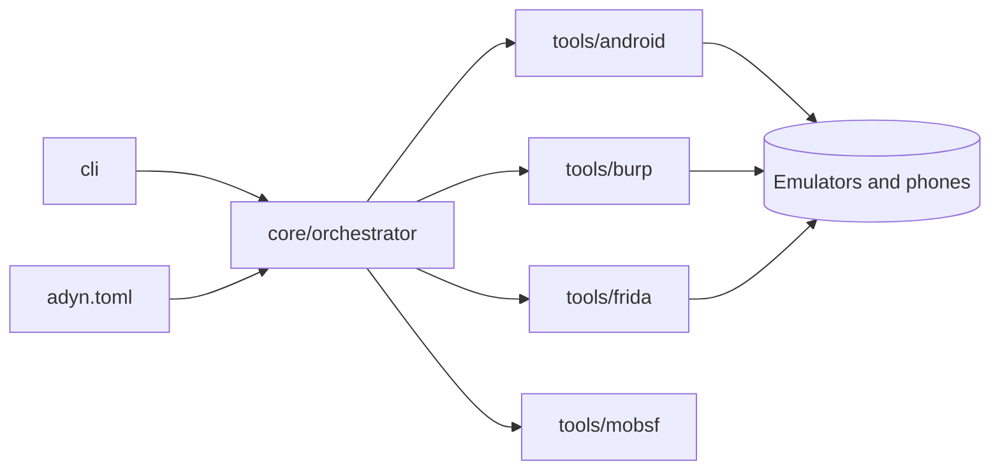

<p align="center">
  <picture>
    <source media="(prefers-color-scheme: dark)" srcset="docs/media/adyn-dark.svg">
    
  </picture>
</p>

<h1 align="center">Adyn</h1>

<p align="center">
  An Android analysis lab, set up with one command.
</p>

<br>

Adyn sets up a lab to analyze Android apps: emulators (one rooted, one not),
Burp Suite with its CA trusted on every device, frida-server on the rooted
ones and MobSF for static analysis. The whole lab is described in one file,
`adyn.toml`.

It is a Python command line tool for Linux and Windows. The setup scripts
install everything it needs, and Android Studio is not required.


## What Adyn Solves

Getting an app ready for dynamic analysis takes many manual steps: create the
emulators, root one of them, start Burp, point the device to it, install its
CA in the system store, push the frida-server that matches your client and
start it as root. Most of it has to be done again after every reboot.

Adyn turns that into a short workflow:

1. Describe the devices in `adyn.toml`.
2. Run `setup` once to create the emulators.
3. Run `up` to boot them with Burp, Frida and MobSF ready, or `start` to
   bring up one piece at a time.
4. Analyze the app, and use `scan` for a static report with MobSF.
5. Run `down` to stop everything.


## Main Features

| Area | Capabilities |
| --- | --- |
| Devices | Rooted and stock emulators created from system images, and physical phones by serial |
| Burp Suite | Started for you, traffic routed with `adb reverse`, CA in the system store on rooted devices |
| Android 14+ | System CA installed in the Conscrypt APEX too, without remounting `/system` |
| Frida | frida-server of the same version as your client, downloaded once and started as root |
| Static analysis | MobSF in Docker, with JSON and PDF reports from one command |
| Configuration | One TOML file, validated when loaded, with clear errors for unknown keys |
| Platforms | Linux and Windows, with an install script for each |


## Architecture Overview



The code is split into a few folders:

- `cli/`: the commands and their arguments.
- `config/`: constants for developers, such as paths and timeouts.
- `core/orchestrator/`: loads `adyn.toml` and runs each command.
- `core/tools/`: one package per tool: `android`, `burp`, `frida`, `mobsf`.
- `setup/`: install scripts for Linux and Windows.


## Quick Start

Install the dependencies, the virtual environment and `adyn.toml`:

**Linux**

```bash
./setup/init.sh
```

**Windows (PowerShell)**

```powershell
powershell -ExecutionPolicy Bypass -File setup\init.ps1
```

Activate the virtual environment:

**Linux**

```bash
source .venv/bin/activate
```

**Windows (PowerShell)**

```powershell
.venv\Scripts\Activate.ps1
```

Create the emulators described in `adyn.toml`:

```bash
python main.py setup
```

Bring up the whole lab: the emulators, Burp, Frida and MobSF:

```bash
python main.py up
```

Or boot a single emulator, chosen from a list:

```bash
python main.py start android
```

Stop everything when you are done:

```bash
python main.py down
```


## Documentation

- [Getting Started](docs/getting-started/README.md)
- [The Lab](docs/lab/README.md)
- [Static Analysis](docs/static-analysis/README.md)
- [Architecture](docs/architecture/README.md)
- [Development](docs/development/README.md)
- [Troubleshooting](docs/troubleshooting/README.md)


## License

Adyn is licensed under the GNU Affero General Public License v3.0. See
[LICENSE](LICENSE).
