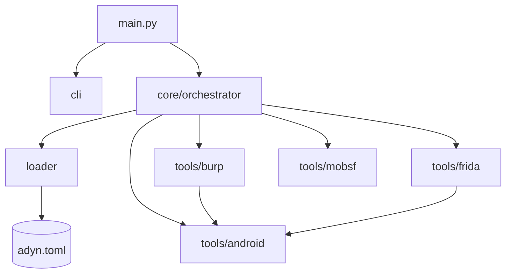
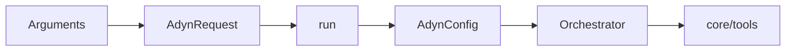

# Architecture

Adyn is a small Python program in layers. The command line turns the
arguments into a request, the orchestrator runs it, and one package per tool
does the real work.


## System Overview



The boundaries are simple:

- `cli/` knows the arguments, and nothing about devices.
- `core/orchestrator/` decides what each command does, in which order and on
  which devices.
- `core/tools/` talks to each tool. A tool package never imports the
  orchestrator.
- `config/` holds the constants, and `adyn.toml` what the user changes.


## Project Layout

```text
Adyn/
    main.py                 Entry point
    adyn.example.toml       Example of adyn.toml
    .adyn/                  Downloads, logs and state, ignored by git
    requirements.txt
    pyproject.toml          ruff, mypy and pytest settings
    setup/                  init.sh and init.ps1
    cli/
    config/
    core/
    tests/                  Mirrors the packages
    docs/
```


## From a Command to the Tools



1. `cli/parser.py` parses the arguments.
2. `main.py` turns them into an `AdynRequest`: the command, the devices and
   the options.
3. `run()` loads `adyn.toml` into an `AdynConfig` and creates the
   `Orchestrator`.
4. The `COMMANDS` registry maps each `Command` to an `Orchestrator` method.
5. The method calls the tool packages.

Errors are `AdynError` subclasses: `ConfigError` for `adyn.toml` and unknown
devices, and `ToolError` for the SDK, `adb`, Burp, Frida, Docker and MobSF.
`main.py` prints them as `error: <message>`.


## Packages

```text
cli/
    arguments.py            Every argument and the valid choices
    parser.py               The parser and its commands
config/
    paths.py                Project, work folder and device paths
    android.py              SDK, emulators, adb timeouts
    burp.py                 Burp paths, defaults and timeouts
    frida.py                frida-server download, path and timeouts
    mobsf.py                MobSF image, API, reports folder and timeouts
    settings.py             Network, logging and exit codes
    env.py                  Environment variables
core/
    exceptions.py           AdynError and its subclasses
    orchestrator/
        models.py           Command, AdynRequest, AdynConfig
        loader.py           Reads adyn.toml
        commands.py         Orchestrator and the command registry
    tools/
        android/
            models.py       Device
            adb.py          adb for one device, and root access
            sdk.py          sdkmanager, avdmanager and the emulator
        burp/
            models.py       BurpOptions
            process.py      The Burp process
            certificate.py  The CA and its Android file name
            proxy.py        Device proxy and CA install
            install_ca.sh   Trusts the CA in the system store
        frida/
            download.py     frida-server download
            server.py       frida-server start and stop
        mobsf/
            models.py       MobsfOptions
            container.py    The Docker container and its API key
            analysis.py     Upload, analysis and reports
    utils/
        files.py            Atomic file writes
        logger.py           The logger
        network.py          HTTP requests that skip any proxy
        system.py           Platform-specific code
        tables.py           Checks TOML tables against a dataclass
```

Each area keeps its data types in its own `models.py`. `AdynConfig` brings
them together: it holds the `Device` list, the `BurpOptions` and the
`MobsfOptions`.


## Platform Code

Everything that depends on the operating system is in
`core/utils/system.py`: where the SDK is by default, the `.exe` and `.bat`
names of the SDK tools, and how background processes are started and
stopped.


## Adding a Tool

MobSF was added this way, and a new tool follows the same steps:

1. Its constants in `config/<tool>.py`.
2. A package in `core/tools/<tool>/`, with its options in `models.py`.
3. Its section in `AdynConfig` and in `adyn.example.toml`.
4. Its commands in `Command`, in the `Orchestrator` and in `COMMANDS`.
5. Its arguments in `cli/arguments.py`.


## Related Pages

- [Development](../development/README.md)
- [Configuration](../getting-started/configuration.md)
