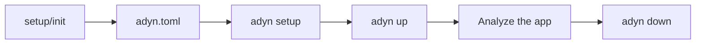

# Getting Started

This section explains how to install Adyn, describe your lab in `adyn.toml`
and use each command.


## Workflow

Every session follows the same steps:



`setup/init` and `adyn setup` are done once. After that, each analysis is
`up`, your work, and `down`.


## Requirements

| Requirement | Why |
| --- | --- |
| Linux (Debian or Ubuntu for the script) or Windows | The platforms the install scripts support |
| Hardware virtualization | KVM on Linux, Windows Hypervisor Platform on Windows, for fast emulators |
| Python 3.11 or later | Adyn reads TOML with `tomllib` |
| Docker | Only for `scan` and MobSF |

The install script takes care of everything else. See
[Installation](installation.md).


## Running Adyn

Adyn runs from its folder, inside its virtual environment:

```bash
python main.py up
```

Every command prints one line per step, and errors start with `error:`:

```text
error: unknown device(s): pixel; known: rooted, stock
```


## Documents

- [Installation](installation.md)
- [Configuration](configuration.md)
- [Command line](cli.md)
