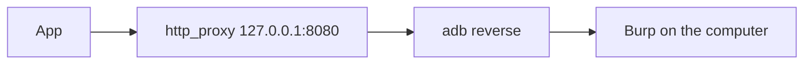

# Burp Suite

Adyn starts Burp, sends the traffic of each device through it and makes the
device trust its CA. This page explains how each step works.

## Starting Burp

`up` and `start burp` start Burp from `.adyn/burpsuite_community.jar`, or
from the `jar` set in `adyn.toml`, and wait until its proxy listens on
`127.0.0.1:<port>`.

| File | Content |
| --- | --- |
| `.adyn/burp.pid` | PID of the Burp started by Adyn |
| `.adyn/logs/burp.log` | Output of Burp |

The first time, Burp asks you to accept its license in its window. Accept it
before `startup_timeout` runs out.

If a Burp is already listening on the port, for example one you opened
yourself, Adyn uses it and never closes it.

## Routing the Traffic

The device reaches Burp through `adb reverse`, which works the same on
emulators and on USB phones:

| Setting | Value |
| --- | --- |
| `adb reverse` | `tcp:<port>` on the device to `tcp:<port>` on the computer |
| Global proxy | `settings put global http_proxy 127.0.0.1:<port>` |

`down` and `stop burp` remove both.

## Trusting the CA

Adyn downloads Burp's CA from `http://127.0.0.1:<port>/cert` and keeps a copy
in `.adyn/burp-ca.der`, so it is available even when Burp is closed.

### Rooted Devices

The CA is installed in the system store, so every app trusts it:

1. The CA is pushed as `/data/local/tmp/<hash>.0`, named after its
   `subject_hash_old`, as Android expects.
2. A tmpfs with the stock CAs plus Burp's is mounted over
   `/system/etc/security/cacerts`, without remounting `/system`.
3. On Android 14 and later, the CAs come from the Conscrypt APEX, so the tmpfs
   is also bind-mounted over `/apex/com.android.conscrypt/cacerts`, inside
   Zygote and every running app.

The mount lasts until the device reboots. `up` installs it again every time.

### Stock Devices

Without root, only the user store can be used. Adyn copies the CA to
`/sdcard/Download/burp-ca.crt`, and you install it by hand from **Settings →
Security → Install a certificate → CA certificate**.

Apps that target Android 7 or later do not trust the user store unless they
allow it, so most of their traffic cannot be read on a stock device.

## Closing Burp

`down` and `stop burp` close Burp only when no device names are given, and
only if Adyn started it. With device names, Burp keeps running for the other
devices.

## Related Pages

- [Devices](devices.md)
- [Troubleshooting](../troubleshooting/README.md#burp-suite)
