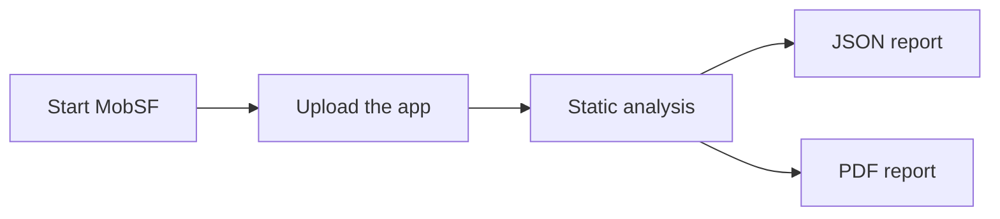

# Static Analysis

Adyn runs MobSF in Docker to analyze an app without installing it, and saves
its report as JSON and PDF. This page explains how the container is managed
and what `scan` produces.


## Workflow



`scan` runs the whole flow:

```bash
python main.py scan shop.apk
```


## The Container

MobSF runs in Docker, so Docker must be installed and usable by your user.

| Part | Value |
| --- | --- |
| Image | `opensecurity/mobile-security-framework-mobsf:latest` |
| Container | `adyn-mobsf` |
| Address | `http://127.0.0.1:<port>`, `8000` by default |
| API key | Random, created once in `.adyn/mobsf-api-key` |

The first start downloads the image, about 1.5 GB, so it takes a while. The
container is only published on `127.0.0.1`, so it cannot be reached from
other machines.

`up` starts the container with the rest of the lab, and `down` stops it.
`scan` also starts it when it is not running, and leaves it running, so the
next scan starts faster. It can be started and stopped on its own too:

```bash
python main.py start mobsf
```

```bash
python main.py stop mobsf
```

While it runs, its web interface is at `http://127.0.0.1:8000`.


## Reports

Each scan saves two files, named after the app, in `reports/` or in the folder
given with `-o`:

```text
reports/
    shop.json
    shop.pdf
```

| File | Content |
| --- | --- |
| `<app>.json` | The full report of MobSF, as returned by its API |
| `<app>.pdf` | The same report, ready to read or share |

Scanning the same app again replaces both files. `reports/` is ignored by
git.


## Related Pages

- [Command line](../getting-started/cli.md#scan)
- [Troubleshooting](../troubleshooting/README.md#mobsf)
